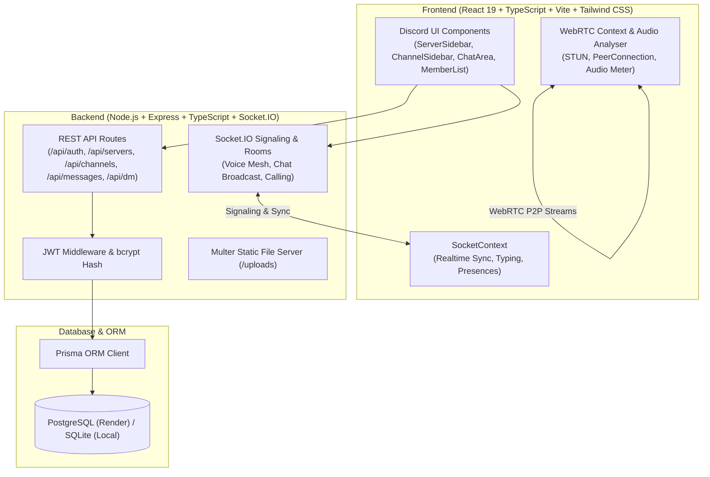

# Discord Clone — Full-Stack WebRTC & Real-Time Messenger 🚀

[](https://render.com/deploy?repo=https://github.com/daniilkopkov12-max/discord-clone)
[](https://github.com/daniilkopkov12-max/discord-clone)
[](https://www.typescriptlang.org/)
[](https://react.dev/)
[](https://webrtc.org/)

Полноценный, функциональный аналог Discord, созданный с нуля. Включает современный интерфейс, бэкенд на Node.js & TypeScript, базу данных PostgreSQL / SQLite с Prisma ORM, WebSockets (Socket.IO) для мгновенного обмена сообщениями и реакциями, а также **настоящие голосовые и видеозвонки и демонстрацию экрана через WebRTC**.


---

## 🌟 Ключевые возможности

### 🎨 1. Интерфейс и дизайн (Discord Dark Theme)
- Точная структура Discord: панель серверов слева, список каналов с категориями, центральная область чата/звонка, правая панель участников, панель профиля внизу слева.
- Акцентные цвета Discord (Blurple `#5865F2`, Green `#57F287`, Red `#ED4245`, Yellow `#FEE75C`).
- Плавные анимации, подсветка активных говорящих (зелёный пульсирующий контур).
- Адаптивная вёрстка под ПК, планшеты и мобильные устройства.

### 👤 2. Аккаунты и аутентификация
- Регистрация и авторизация (хеширование паролей bcrypt, JWT токены в cookies/headers).
- Профиль пользователя: аватар, баннер, имя, уникальный тег, статус (В сети, Не активен, Не беспокоить, Невидимый) и кастомный статус.
- Настройки профиля, звука, темы оформления и тест микрофона с живым индикатором громкости (Web Audio API).
- Встроенные кнопки быстрого входа для тестирования (`AlexDev` и `SarahTech`).

### 🏰 3. Серверы, каналы и роли
- Создание собственных серверов с иконкой и названием.
- Генерация ссылок-приглашений (например, `nexus123`) и присоединение по ссылке.
- Текстовые (`#general`, `#media-share`) и голосовые каналы (`General Voice`).
- Категории каналов с возможностью сворачивания/разворачивания.
- Роли и серверная проверка прав доступа (Administrator, Moderator, Member).

### 💬 4. Сообщения в реальном времени (WebSockets)
- Отправка и получение сообщений без перезагрузки страницы.
- Редактирование и удаление собственных сообщений.
- Ответы на сообщения (Reply quote preview).
- Эмодзи-реакции (несколько реакций на сообщение, мгновенный подсчёт).
- Закреплённые сообщения (Pinned messages drawer).
- Индикатор набора текста («Пользователь печатает...»).
- Загрузка и скачивание изображений и файлов (с предпросмотром и лайтбоксом).
- Звуковые оповещения об отправке и получении сообщений (синтезатор Web Audio API).

### 🎙️ 5. Голосовые, видеозвонки и демонстрация экрана (WebRTC)
- **100% реальные звонки через WebRTC** с STUN-серверами Google (`stun:stun.l.google.com:19302`).
- Голосовые каналы: автоматическое подключение, список участников, индикатор говорящих в реальном времени.
- Включение/выключение веб-камеры с переключением на видеосетку.
- Демонстрация экрана браузера / окон приложений через `getDisplayMedia`.
- Звонки один на один (Direct Call) со звуком вызова (Ringtone), принятием и отклонением.
- Отключение микрофона (Mute) и наушников (Deafen).

### 📬 6. Личные сообщения и Друзья
- Список друзей: Онлайн, Все, Ожидание, Добавить в друзья.
- Отправка заявок в друзья по юзернейму, принятие и отклонение.
- 1-on-1 и групповые личные чаты (Group DMs).

---

## 🏗 Архитектура проекта



---

## 🚀 Быстрый запуск локально

### 1. Клонирование репозитория
```bash
git clone <URL_РЕПОЗИТОРИЯ>
cd discord-clone
```

### 2. Установка зависимостей
```bash
# Установка зависимостей клиента и сервера
cd client && npm install
cd ../server && npm install
cd ..
```

### 3. Настройка переменных окружения
Скопируйте `.env.example` в `server/.env`:
```bash
cp .env.example server/.env
```

### 4. Инициализация базы данных и сидирование тестовых пользователей
```bash
cd server
npx prisma db push
npx tsx prisma/seed.ts
cd ..
```

Скрипт создаст:
- Пользователя 1: `AlexDev` (`alex@discord.local` / пароль `Password123!`)
- Пользователя 2: `SarahTech` (`sarah@discord.local` / пароль `Password123!`)
- Сервер сообщества: `Nexus Lounge` с текстовыми и голосовыми каналами

### 5. Запуск в режиме разработки
```bash
# Терминал 1 (Бэкенд):
cd server && npm run dev

# Терминал 2 (Фронтенд):
cd client && npm run dev
```

Откройте [http://localhost:5173](http://localhost:5173) в двух вкладках браузера для мгновенного тестирования взаимодействия!

---

## 🌐 Развёртывание на Render

Проект полностью оптимизирован для развёртывания на [Render](https://render.com) как единый сервис или по схеме `render.yaml Blueprint`:

### Способ 1: Автоматический через Blueprint (`render.yaml`)
1. Зайдите в панель [dashboard.render.com](https://dashboard.render.com).
2. Нажмите **New +** -> **Blueprint**.
3. Выберите ваш GitHub репозиторий с проектом.
4. Render автоматически создаст:
   - **PostgreSQL Database** (`discord-postgres`).
   - **Web Service** (`discord-clone`), настроит переменные окружения и запустит сборку.

### Способ 2: Ручная настройка Web Service на Render
1. Создайте **New PostgreSQL Database** на Render (имя: `discord-db`, план: Free).
2. Скопируйте **Internal Database URL**.
3. Создайте **New Web Service**:
   - **Environment**: Node
   - **Build Command**: `npm run build`
   - **Start Command**: `npm start`
   - **Environment Variables**:
     - `NODE_ENV` = `production`
     - `DATABASE_URL` = `<Ваш Internal Database URL из шага 2>`
     - `JWT_SECRET` = `<Сгенерированная любая строка>`
     - `PORT` = `10000`
4. Нажмите **Create Web Service**. При сборке Prisma автоматически применит схему к PostgreSQL и запустит сид базы данных!

---

## 🧪 Тестовые учётные записи

В интерфейсе входа предусмотрены кнопки быстрого входа в один клик:
- **AlexDev**: Host / Owner сервера `Nexus Lounge`.
- **SarahTech**: Moderator сервера `Nexus Lounge`.

Код приглашения на сервер: `nexus123`.

---

## 📄 Лицензия
MIT License. Создано для демонстрации современных возможностей WebRTC и веб-разработки в реальном времени.
